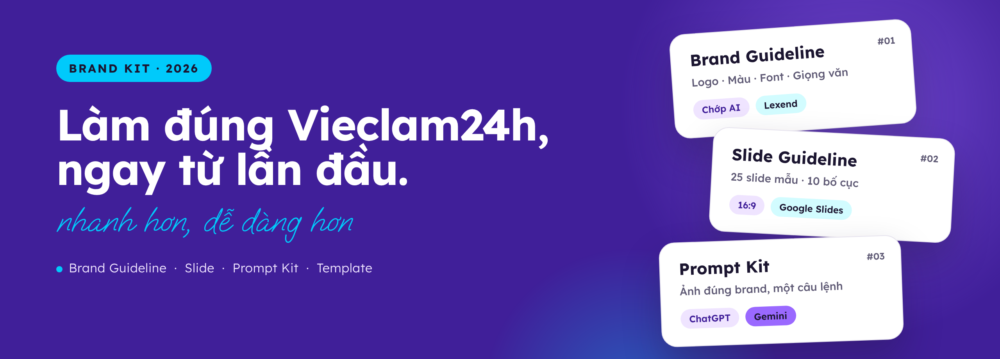
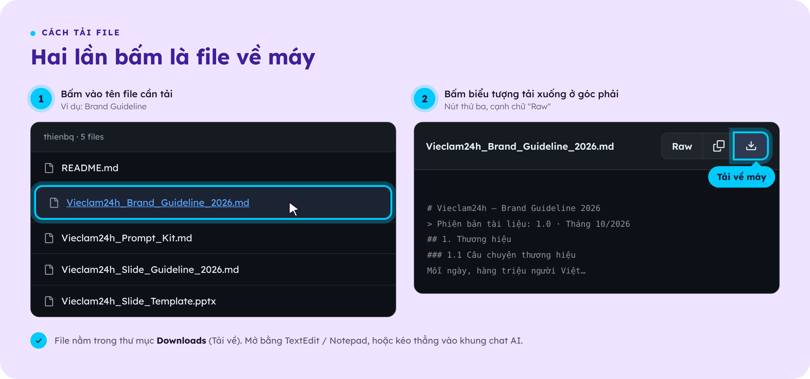
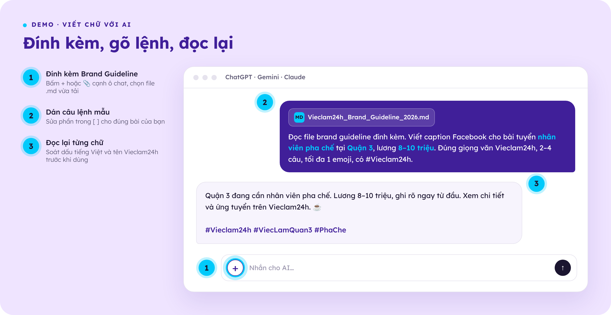
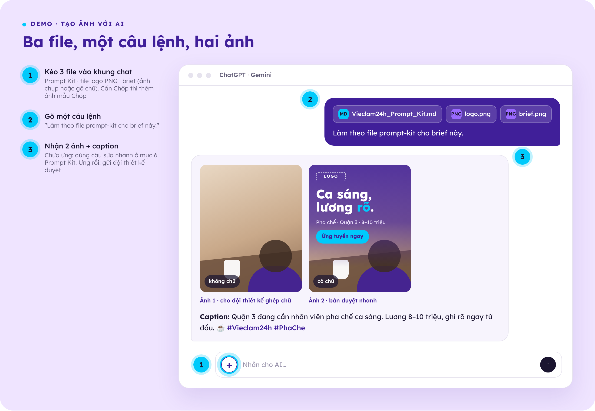
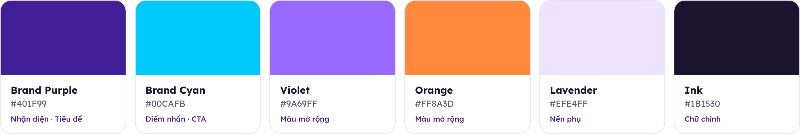

<p align="center">
  
</p>

<p align="center">
  Đủ đồ nghề để mọi thứ mang tên Vieclam24h ra cùng một chất, từ mã màu tới slide báo cáo quý.<br>
  <sub>Không cần biết code. Mở đúng file là xong nửa việc.</sub>
</p>

<p align="center">
  <a href="https://vieclam24h-brandguideline.web.app"><b>🌐 Mở website Brand Guideline</b></a><br>
  <sub>Logo, font, màu, Chớp Studio và các công cụ làm ấn phẩm đều ở đó, bấm là tải.</sub>
</p>

<br>

<sub>BẮT ĐẦU TỪ ĐÂY</sub>

## Hôm nay bạn cần gì?

| Cần làm | Đi tới |
|---|---|
| **Slide thuyết trình** | [03 · Làm slide](#03--làm-slide) |
| **Caption, thông báo, nội dung** | [04 · Viết chữ với AI](#04--viết-chữ-với-ai) |
| **Ảnh bài đăng** | [05 · Tạo ảnh với AI](#05--tạo-ảnh-với-ai) |
| **Tải logo** | [Web · Logo](https://vieclam24h-brandguideline.web.app/#logo) |
| **Cài font** | [Web · Chữ](https://vieclam24h-brandguideline.web.app/#chu) |
| **Ảnh Chớp** | [Chớp Studio](https://vieclam24h-brandguideline.web.app/chop.html): chọn pose, đổi mặt, tải PNG nền trong suốt |
| **Job card, Việc Xịn, Welcome Onboard, Vinh danh** | [Web · Công cụ & mẫu](https://vieclam24h-brandguideline.web.app/#material): điền chữ, tải ảnh |
| **Mã màu, giọng văn** | [Brand Guideline](Vieclam24h_Brand_Guideline_2026.md), đọc ngay trên trang |

<sub>Mới vào? Đọc mục 01 và 02 trước. Phần còn lại, cần gì tra nấy.</sub>

<br>

<sub>01 — LUẬT CHƠI</sub>

## 01 · Ba điều không thương lượng

**① `Vieclam24h`. Một cách viết, mọi nơi.**<br>
V hoa, viết liền, không dấu. Slide, bài đăng, email, tên file: như nhau.<br>
<sub>❌ VL24H · VL24 · vieclam24h · VIECLAM24H · Việc Làm 24h · ViecLam24h</sub>

**② Slide bắt đầu từ file mẫu, không từ trang trắng.**<br>
[`Vieclam24h_Slide_Template_11-11-2026.pptx`](Vieclam24h_Slide_Template_11-11-2026.pptx) là điểm xuất phát. Không dùng mẫu có sẵn của Google Slides hay PowerPoint.

**③ AI làm nhanh, người duyệt kỹ.**<br>
Cho AI đọc file quy chuẩn rồi mới giao việc. AI **không sửa nội dung của bạn**, chỉ ghi đề xuất. Đội thiết kế chưa duyệt thì chưa gửi, chưa đăng.

<br>

<sub>02 — TRONG HỘP CÓ GÌ</sub>

## 02 · Đồ nghề trong hộp

| | File | Dùng khi |
|:---:|---|---|
| **A** | [**Brand Guideline 2026**](Vieclam24h_Brand_Guideline_2026.md) | Tra logo, màu, font, giọng văn, Chớp AI · Đính kèm cho AI khi nhờ viết chữ |
| **A+** | [**Brand Guideline 2026 · PDF**](Vieclam24h_Brand_Guideline_2026_Draft_19.10.pdf) | Xem bằng mắt · Bản nháp 19.10.2026, chưa final · File nặng, đừng gửi cho AI |
| **B** | [**Slide Guideline · 11.11.2026**](Vieclam24h_Slide_Guideline_11-11-2026.md) | Tra cỡ chữ, bố cục · Đính kèm cho AI khi nhờ soạn slide |
| **C** | [**Slide Template · 11.11.2026**](Vieclam24h_Slide_Template_11-11-2026.pptx) | Mọi bài thuyết trình · 30 slide mẫu |
| **D** | [**Prompt Kit**](Vieclam24h_Prompt_Kit.md) | Đính kèm cho ChatGPT / Gemini khi nhờ tạo ảnh |

<sub>File <b>.md</b> là file chữ: bấm tên là đọc được, máy nào cũng mở được, AI nào cũng nhận.</sub>

**Tải về:** bấm tên file → bấm ⤓ ở góc phải (cạnh chữ *Raw*).

<p align="center">
  
</p>

<br>

<sub>03 — THUYẾT TRÌNH</sub>

## 03 · Làm slide

Hai lối đi, cùng về một đích: **file mẫu Vieclam24h**.

<details>
<summary><b>▸ Cách 1 · Tự làm</b> &nbsp;<sub>(bấm để mở)</sub></summary>

<br>

1. Tải **C · Slide Template**.
2. Google Drive → **Mới** → **Tải tệp lên** → bấm đúp file → **Mở bằng Google Trang trình bày** → **Tệp** → **Lưu dưới dạng Google Trang trình bày**.
3. Đặt tên: `Vieclam24h_[Nội dung]_[MM.YYYY]`, ví dụ `Vieclam24h_Bao-cao-Q3_10.2026`.
4. Cần dạng slide nào → chuột phải slide mẫu → **Nhân bản** → sửa trên bản sao. Đổi ảnh: chuột phải → **Thay hình ảnh**.
5. Xoá slide hướng dẫn (số 2) và slide mẫu không dùng.
6. Soát theo **mục 10** file **B** → **Tệp** → **Tải xuống** → **PDF**.

<sub>Dùng PowerPoint? Cài trước font <b>Lexend</b> và <b>Oooh Baby</b> (link ở <a href="https://vieclam24h-brandguideline.web.app/#chu">web · Chữ</a>), không thì chữ tự đổi font.</sub>

</details>

<details>
<summary><b>▸ Cách 2 · Nhờ AI xếp nội dung vào slide mẫu</b> &nbsp;<sub>(bấm để mở)</sub></summary>

<br>

AI xếp chữ của bạn vào đúng slide mẫu, **không sửa một chữ**. Thấy chỗ nên sửa thì ghi riêng thành **Đề xuất**, bạn chốt.

1. Tải **B · Slide Guideline** → đính kèm vào ChatGPT, Gemini hoặc Claude (nút **+** hoặc 📎).
2. Dán câu lệnh, sửa phần `[ ]`, gửi:

```
Đọc file quy chuẩn slide Vieclam24h đính kèm. Xếp nội dung dưới đây vào các slide mẫu ở mục 6 cho bài thuyết trình dành cho [người nghe].
Giữ nguyên 100% nội dung gốc: từng chữ, từng con số, thứ tự ý. Không viết lại, không cắt bớt, không thêm. Quá dài thì chia sang nhiều slide. Chỗ bản gốc không có thì ghi [THIẾU].
Trả lời 2 phần:
PHẦN A: Dàn slide nguyên văn (slide mẫu số mấy · dòng chủ đề nhỏ · tiêu đề · nội dung · nguồn).
PHẦN B: Đề xuất, không tự áp dụng (bảng: Slide · Vấn đề · Nội dung gốc · Đề xuất sửa · Lý do).
Nội dung: [dán nội dung]
```

3. Đọc **Phần B**, tự chọn sửa gì.
4. Làm tiếp **Cách 1**: nhân bản đúng slide AI chọn, dán **Phần A** vào.

<sub>Thêm câu lệnh góp ý: mục 9 file B.</sub>

</details>

<br>

<sub>04 — LÀM VIỆC VỚI AI</sub>

## 04 · Viết chữ với AI

ChatGPT, Gemini hay Claude đều được. Cho AI đọc guideline trước, rồi mới giao việc. AI chấp bút, bạn duyệt cuối.

<p align="center">
  
</p>

1. Đính kèm **A · Brand Guideline** vào ô chat.
2. Chọn câu lệnh bên dưới, sửa phần `[ ]`, gửi.
3. Đọc lại từng chữ. AI viết nhanh, dấu tiếng Việt thì thỉnh thoảng trượt.

<details>
<summary><b>▸ Câu lệnh mẫu</b> &nbsp;<sub>(bấm để mở)</sub></summary>

<br>

**Caption Facebook**
```
Đọc file brand guideline đính kèm. Viết caption Facebook cho bài tuyển [vị trí] tại [khu vực], lương [mức lương]. Đúng giọng văn Vieclam24h, 2–4 câu, tối đa 1 emoji, có #Vieclam24h.
```

**Thông báo trong app**
```
Đọc file brand guideline đính kèm. Viết 3 phương án thông báo app để báo người dùng [nội dung]. Tiêu đề tối đa 40 ký tự, nội dung tối đa 120 ký tự.
```

**Soát đoạn văn đã viết**
```
Đọc file brand guideline đính kèm. Kiểm tra đoạn văn dưới đây có đúng giọng văn Vieclam24h và viết đúng tên thương hiệu "Vieclam24h" không, chỉ ra chỗ chưa đúng và viết lại giúp tôi:
[dán đoạn văn]
```

**Hỏi nhanh quy chuẩn**
```
Đọc file brand guideline đính kèm. [Ví dụ: Mã màu tím chủ đạo là gì? / Story để lề bao nhiêu? / Logo đặt ở đâu?]
```

</details>

<br>

<sub>05 — LÀM VIỆC VỚI AI</sub>

## 05 · Tạo ảnh với AI

Ba file, một câu lệnh, hai ảnh. Dùng **ChatGPT hoặc Gemini** (Claude không vẽ ảnh).

<p align="center">
  
</p>

1. Kéo vào ô chat: **D · Prompt Kit** + **logo PNG** ([tải ở web](https://vieclam24h-brandguideline.web.app/#logo)) + **brief** (ảnh chụp hoặc gõ headline, lương, địa điểm).
2. Gõ: `Làm theo file prompt-kit cho brief này.`
3. Nhận **2 ảnh** (có chữ, không chữ) + **caption** → gửi đội thiết kế duyệt.

**Cần Chớp góp mặt?** Thêm ảnh Chớp (lấy ở [Chớp Studio](https://vieclam24h-brandguideline.web.app/chop.html)) và giao việc cụ thể. Chớp đi làm, không đứng cho đủ hình:<br>
`Làm theo file prompt-kit cho brief này, có Chớp, Chớp [đang làm gì, ví dụ: cầm bảng lương chỉ vào headline].`

<sub>Sai chữ, sai Chớp, AI tự vẽ logo? Mục 6 <i>Câu sửa nhanh</i> trong file D có sẵn câu để gõ tiếp.</sub>

<br>

<sub>06 — TRA NHANH</sub>

## 06 · Sáu màu, đủ dùng

<p align="center">
  
</p>

Tím giữ nhận diện, cyan kéo ánh nhìn, nền sáng chừa chỗ thở: **~50% nền sáng · ~30% Purple · ~15% màu nhấn.**<br>
<sub>RGB, CMYK, độ tương phản: mục 3 file A.</sub>

<br>

<sub>07 — TRƯỚC KHI BẤM GỬI</sub>

## 07 · Bốn điều nên nhớ

- **Dữ liệu nội bộ không đi chơi với AI.** Số kinh doanh, khách hàng, ứng viên: giữ trong nhà.
- **Logo dùng file gốc** [tải ở web](https://vieclam24h-brandguideline.web.app/#logo). Không để AI vẽ, không tự gõ lại.
- **Đọc lại trước khi gửi.** Sai một dấu ở tên thương hiệu là cả thiết kế mất điểm.
- **Bản mới nhất nằm ở đây.** Bản trong máy bạn từ tháng trước có thể đã cũ. Tên file có ngày cập nhật, nhìn là biết.

<br>

---

<p align="center">
  <sub>Gặp trường hợp guideline chưa nói tới?</sub><br>
  <sub><b>Hỏi đội thương hiệu trước, làm sau.</b></sub><br><br>
  <sub>Vieclam24h · Brand Kit 1.3 · cập nhật 11.11.2026</sub>
</p>
