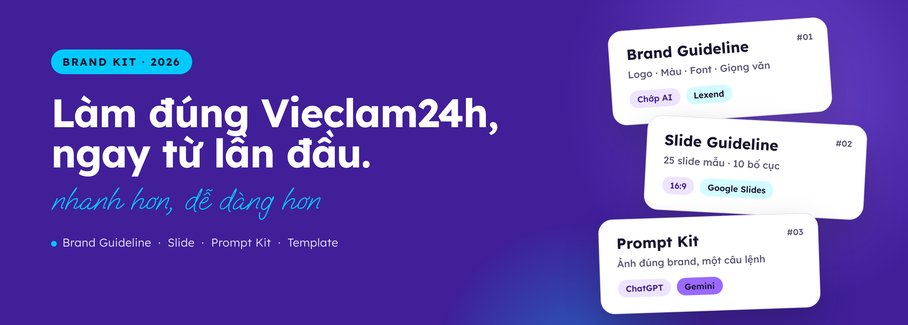
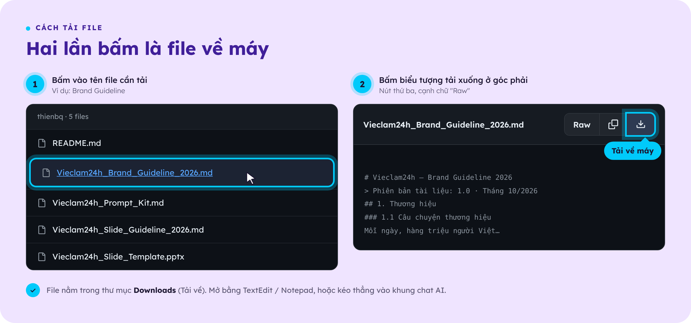
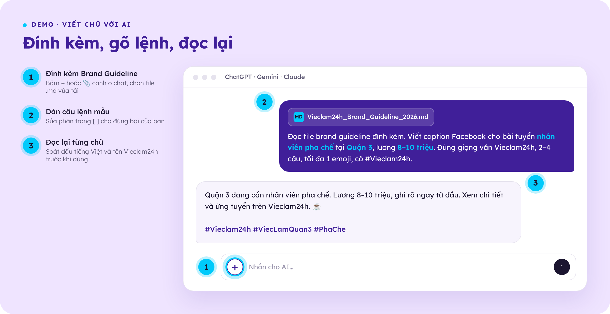
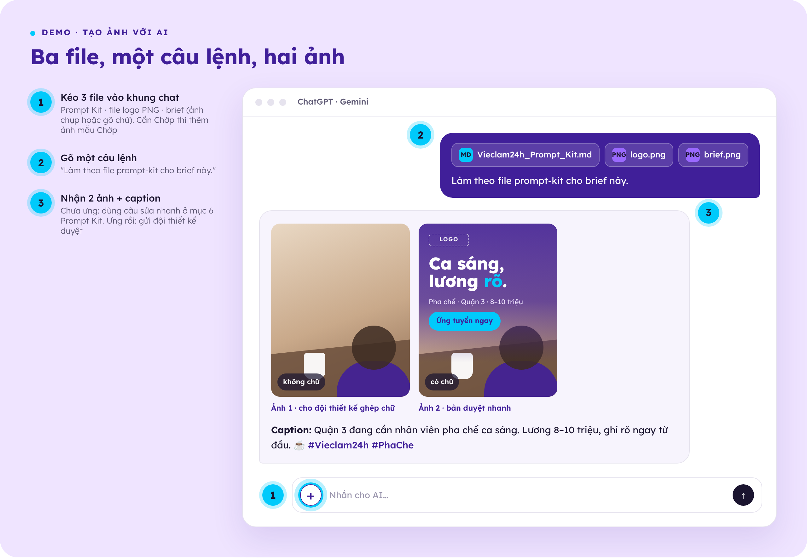
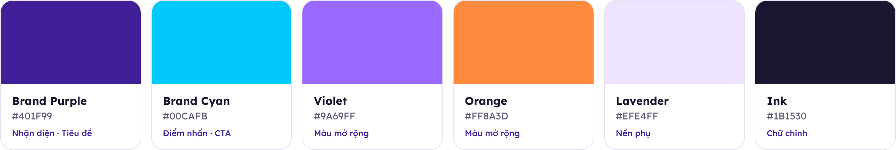

<p align="center">
  
</p>

<p align="center">
  Một repo, đủ đồ nghề để mọi thứ mang tên Vieclam24h ra cùng một chất: từ mã màu đến slide báo cáo quý.<br>
  <sub>Không cần biết code. Không cần rành AI. Chỉ cần mở đúng file.</sub>
</p>

<br>

<sub>BẮT ĐẦU TỪ ĐÂY</sub>

## Hôm nay bạn cần gì?

| Việc cần làm | Xem mục | File cần dùng |
|---|---|---|
| **Làm slide thuyết trình** | [Mục 03 · Làm slide](#03--làm-slide) | Slide Template (+ Slide Guideline nếu dùng AI) |
| **Viết caption, thông báo, nội dung** | [Mục 04 · Viết chữ với AI](#04--viết-chữ-với-ai) | Brand Guideline |
| **Tạo ảnh bài đăng** | [Mục 05 · Tạo ảnh với AI](#05--tạo-ảnh-với-ai) | Prompt Kit + logo + brief |
| **Tra mã màu, logo, font, giọng văn** | Mở [Brand Guideline](Vieclam24h_Brand_Guideline_2026.md) đọc ngay trên trang | — |

<sub>Mới vào? Dành 2 phút cho mục 01 và 02. Rẻ hơn nhiều so với một lần sửa slide lúc 11 giờ đêm.</sub>

<br>

<sub>01 — LUẬT CHƠI</sub>

## 01 · Ba điều không thương lượng

**① Tên chỉ có một cách viết: `Vieclam24h`**<br>
V viết hoa, viết liền, không dấu. Không nickname, không viết tắt cho nhanh. Slide, bài đăng, email hay tên file đều vậy.<br>
<sub>❌ VL24H · VL24 · vieclam24h · VIECLAM24H · Việc Làm 24h · ViecLam24h</sub>

**② Làm slide bằng cơm? File mẫu là điểm xuất phát, không phải gợi ý.**<br>
Mọi bài thuyết trình bắt đầu từ file mẫu [`Vieclam24h_Slide_Template.pptx`](Vieclam24h_Slide_Template.pptx). Không làm trên slide trắng, không dùng mẫu có sẵn của Google Slides hay PowerPoint.

**③ Dùng AI? Cho nó đọc bài trước khi giao việc.**<br>
Đính kèm đúng file quy chuẩn (bảng bên dưới) rồi mới ra đề. Khi áp template, **AI không được sửa nội dung của bạn**, chỉ được ghi đề xuất. AI làm nhanh, **đội thiết kế duyệt kỹ**: chưa duyệt thì chưa gửi, chưa đăng.

<br>

<sub>02 — TRONG HỘP CÓ GÌ</sub>

## 02 · Đồ nghề trong hộp

| | File | Là gì | Dùng khi |
|:---:|---|---|---|
| **A** | [**Brand Guideline 2026**](Vieclam24h_Brand_Guideline_2026.md) | Toàn bộ quy chuẩn thương hiệu | Tra logo, màu, font, giọng văn, Chớp AI · Đính kèm cho AI khi nhờ viết chữ |
| **B** | [**Slide Guideline 2026**](Vieclam24h_Slide_Guideline_2026.md) | Quy chuẩn làm slide | Đính kèm cho AI khi nhờ soạn slide · Tra cỡ chữ, bố cục |
| **C** | [**Slide Template**](Vieclam24h_Slide_Template.pptx) | File mẫu thuyết trình, 25 slide mẫu | Mọi bài thuyết trình |
| **D** | [**Prompt Kit**](Vieclam24h_Prompt_Kit.md) | Hướng dẫn cho AI cách tạo ảnh đúng brand | Đính kèm cho ChatGPT / Gemini khi nhờ tạo ảnh |

<sub>Các file đuôi <b>.md</b> là file chữ thường: bấm vào tên là đọc được ngay trên trang này, tải về thì mở được bằng mọi máy và đính kèm được vào mọi AI.</sub>

**Tải về máy, hai cú bấm:** bấm vào tên file → bấm nút tải xuống ⤓ ở góc phải (cạnh chữ *Raw*).

<p align="center">
  
</p>

<br>

<sub>03 — THUYẾT TRÌNH</sub>

## 03 · Làm slide

Hai lối đi, chung một điểm về: **file mẫu Vieclam24h**.<br>
<sub>👇 Bấm vào từng dòng bên dưới để mở hướng dẫn.</sub>

<details>
<summary><b>▸ Cách 1 · Tự làm, không dùng AI</b> &nbsp;<sub>(bấm để mở)</sub></summary>

<br>

1. Tải file **C · Slide Template** về máy (xem cách tải ở mục 02).
2. Mở **Google Drive** → bấm **Mới** → **Tải tệp lên** → chọn file vừa tải.
3. Bấm đúp vào file trên Drive → chọn **Mở bằng Google Trang trình bày** → menu **Tệp** → **Lưu dưới dạng Google Trang trình bày**.
4. Đổi tên file: `Vieclam24h_[Tên nội dung]_[MM.YYYY]`, ví dụ `Vieclam24h_Bao-cao-Q3_10.2026`.
5. Cần dạng slide nào → chuột phải vào slide mẫu đó → **Nhân bản trang trình bày** → sửa chữ trên bản sao.<br>
   Thay ảnh: chuột phải vào ảnh → **Thay hình ảnh**.
6. Xoá slide hướng dẫn (slide số 2) và các slide mẫu không dùng.
7. Soát theo danh sách ở **mục 10** của file **B · Slide Guideline** → **Tệp** → **Tải xuống** → **Tài liệu PDF** để gửi.

<sub>Dùng PowerPoint thay vì Google Slides? Cài trước 2 font <b>Lexend</b> và <b>Oooh Baby</b> (miễn phí tại fonts.google.com), nếu không chữ sẽ bị đổi sang font khác.</sub>

</details>

<details>
<summary><b>▸ Cách 2 · Nhờ AI xếp nội dung vào slide mẫu, rồi đổ vào file mẫu</b> &nbsp;<sub>(bấm để mở)</sub></summary>

<br>

AI **xếp nội dung của bạn vào đúng slide mẫu, không sửa một chữ nào**. Thấy chỗ có vấn đề thì AI ghi ra một danh sách **Đề xuất** riêng, bạn đọc rồi tự quyết. Slide do AI tự thiết kế thì để AI tự xem.

1. Tải file **B · Slide Guideline** về máy.
2. Mở ChatGPT, Gemini hoặc Claude → bấm **+** hoặc 📎 cạnh ô chat → chọn file vừa tải.
3. Copy câu lệnh dưới đây (bấm biểu tượng 📋 ở góc phải khung), dán vào ô chat, sửa phần trong `[ ]`, rồi gửi:

```
Đọc file quy chuẩn slide Vieclam24h đính kèm. Xếp nội dung dưới đây vào các slide mẫu ở mục 6 cho bài thuyết trình dành cho [người nghe].
Giữ nguyên 100% nội dung gốc: từng chữ, từng con số, thứ tự ý. Không viết lại, không cắt bớt, không thêm. Quá dài thì chia sang nhiều slide. Chỗ bản gốc không có thì ghi [THIẾU].
Trả lời 2 phần:
PHẦN A: Dàn slide nguyên văn (slide mẫu số mấy · dòng chủ đề nhỏ · tiêu đề · nội dung · nguồn).
PHẦN B: Đề xuất, không tự áp dụng (bảng: Slide · Vấn đề · Nội dung gốc · Đề xuất sửa · Lý do).
Nội dung: [dán nội dung]
```

4. Đọc **Phần B**, tự chọn đề xuất nào nên sửa. Bạn là người chốt nội dung, không phải AI.
5. Làm tiếp **Cách 1** từ bước 1: nhân bản đúng slide mẫu AI chọn, dán nội dung Phần A vào.

<sub>Câu lệnh đầy đủ và các câu lệnh góp ý khác: mục 9 của file B · Slide Guideline.</sub>

</details>

<br>

<sub>04 — LÀM VIỆC VỚI AI</sub>

## 04 · Viết chữ với AI

**ChatGPT, Gemini hay Claude** đều được. Luật bất thành văn: **cho AI đọc guideline trước, rồi mới giao việc.** AI chấp bút, bạn là người duyệt cuối.

<p align="center">
  
</p>

1. Tải file **A · Brand Guideline** về máy.
2. Mở AI → bấm **+** hoặc 📎 cạnh ô chat → chọn file vừa tải.
3. Mở danh sách câu lệnh bên dưới → copy câu phù hợp → dán vào ô chat → sửa phần trong `[ ]` → gửi.
4. Đọc lại từng chữ trước khi dùng. AI viết nhanh, nhưng dấu tiếng Việt thì thỉnh thoảng trượt.

<details>
<summary><b>▸ Câu lệnh mẫu để copy</b> &nbsp;<sub>(bấm để mở)</sub></summary>

<br>

**Caption Facebook**
```
Đọc file brand guideline đính kèm. Viết caption Facebook cho bài tuyển [vị trí] tại [khu vực], lương [mức lương]. Đúng giọng văn Vieclam24h, 2–4 câu, tối đa 1 emoji, có #Vieclam24h.
```

**Thông báo trong app**
```
Đọc file brand guideline đính kèm. Viết 3 phương án thông báo app để báo người dùng [nội dung]. Tiêu đề tối đa 40 ký tự, nội dung tối đa 120 ký tự.
```

**Soát một đoạn văn đã viết**
```
Đọc file brand guideline đính kèm. Kiểm tra đoạn văn dưới đây có đúng giọng văn Vieclam24h và viết đúng tên thương hiệu "Vieclam24h" không, chỉ ra chỗ chưa đúng và viết lại giúp tôi:
[dán đoạn văn]
```

**Hỏi nhanh quy chuẩn**
```
Đọc file brand guideline đính kèm. [Ví dụ: Mã màu tím chủ đạo là gì? / Story để lề bao nhiêu? / Logo đặt ở đâu?]
```

</details>

<br>

<sub>05 — LÀM VIỆC VỚI AI</sub>

## 05 · Tạo ảnh với AI

Ba file, một câu lệnh, hai ảnh. Dùng **ChatGPT hoặc Gemini** (Claude không tạo được ảnh). Nhớ đăng nhập; tài khoản miễn phí có thể bị giới hạn số ảnh mỗi ngày.

<p align="center">
  
</p>

1. Chuẩn bị 3 thứ:
   - File **D · Prompt Kit** (tải ở mục 02)
   - **File logo PNG**: xin đội thiết kế
   - **Brief** (nội dung bài đăng): ảnh chụp, hoặc gõ thẳng headline, lương, địa điểm vào ô chat
2. Kéo tất cả vào khung chat, gõ: `Làm theo file prompt-kit cho brief này.`
3. AI trả về **2 ảnh** (1 ảnh không chữ, 1 ảnh có chữ) và **caption**. Gửi cả 3 cho đội thiết kế duyệt.

**Muốn Chớp góp mặt?** Thêm **ảnh mẫu Chớp** (xin đội thiết kế) và giao vai rõ ràng trong câu lệnh. Chớp phải có việc để làm, không đứng cho đủ hình:<br>
`Làm theo file prompt-kit cho brief này, có Chớp, Chớp [đang làm gì, ví dụ: cầm bảng lương chỉ vào headline].`

<sub>Ảnh chưa ưng (sai chữ, sai Chớp, AI tự vẽ logo…)? Mở file D · Prompt Kit, mục 6 <i>Câu sửa nhanh</i>, copy câu phù hợp gõ tiếp vào cùng khung chat.</sub>

<br>

<sub>06 — TRA NHANH</sub>

## 06 · Sáu màu, đủ dùng

<p align="center">
  
</p>

Tím giữ nhận diện, cyan kéo ánh nhìn, nền sáng chừa chỗ thở. Tỷ lệ trên một thiết kế: **~50% nền sáng · ~30% Purple · ~15% màu nhấn.**<br>
Thông số đầy đủ (RGB, CMYK, độ tương phản): mục 3 của file **A · Brand Guideline**.

<br>

<sub>07 — TRƯỚC KHI BẤM GỬI</sub>

## 07 · Bốn điều nên nhớ

- **Dữ liệu nội bộ không đi chơi với AI.** Số liệu kinh doanh, thông tin khách hàng, ứng viên: giữ trong nhà.
- **Logo chỉ có một bản chính chủ: file gốc.** Không để AI vẽ, không tự gõ lại.
- **Đọc lại trước khi gửi.** Một chữ sai dấu đủ làm cả thiết kế mất điểm, nhất là tên thương hiệu.
- **Bản mới nhất luôn ở đây.** File nằm trong máy bạn từ tháng trước có thể đã cũ.

<br>

---

<p align="center">
  <sub>Có trường hợp chưa nằm trong guideline, hoặc cần file logo, ảnh mẫu Chớp, font?</sub><br>
  <sub><b>Hỏi đội thương hiệu trước, làm sau.</b></sub><br><br>
  <sub>Vieclam24h · Brand Kit 1.2 · 10.2026</sub>
</p>
